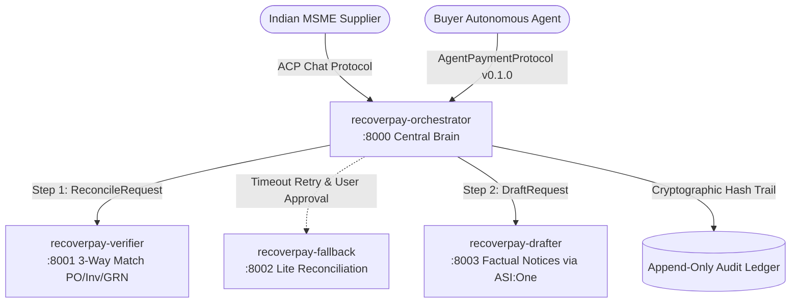

# RecoverPay 🛡️💰


> **Autonomous Multi-Agent Delayed Payment Resolution System for Indian MSMEs under the MSMED Act 2006.**

RecoverPay empowers Micro and Small enterprises to recover overdue commercial payments without expensive legal retainers. By orchestrating specialized Fetch.ai agents, RecoverPay automates 3-way evidence reconciliation, computes Section 16 statutory compound interest, generates guardrailed factual notices, and facilitates direct autonomous settlement via the Fetch.ai Agent Payment Protocol.

---

## 🏛️ Regulatory Context: MSMED Act 2006

- **Section 15**: Buyers must make payment within agreed terms (capped at **45 days** statutory maximum, or **15 days** if no written agreement).
- **Section 16**: Delayed payments mandate compound interest with monthly rests at **three times (3×) the RBI Bank Rate**.
- **Section 2(n)**: Mandatory verification of supplier Udyam registration before asserting statutory delayed-payment claims.

---

## 🤖 Multi-Agent Architecture

RecoverPay operates as a distributed system of four specialized autonomous agents communicating over Fetch.ai's **Agent Communication Protocol (ACP)** and **Agent Payment Protocol (v0.1.0)**:



| Agent Name | Port | Run Command | Role & Responsibility |
|---|:---:|---|---|
| **`recoverpay-orchestrator`** | `8000` | `python -m agents.orchestrator.agent` | **Central Coordinator**: Enforces Udyam eligibility gates, state machine transitions, timeout detection, human-in-the-loop approvals, and settlement receipt. |
| **`recoverpay-verifier`** | `8001` | `python -m agents.verifier.agent` | **Evidence Engine**: Performs full 3-way reconciliation across PO, Tax Invoice, and Delivery Proof (GRN) to identify audit gaps. |
| **`recoverpay-fallback`** | `8002` | `python -m agents.fallback.agent` | **Resilience Agent**: Executes rule-based fallback reconciliation in `lite` mode with fewer checks when evidence is incomplete or verifier times out. |
| **`recoverpay-drafter`** | `8003` | `python -m agents.drafter.agent` | **Notice Specialist**: Synthesizes neutral, non-threatening payment reminders and document requests inside fixed review banners via ASI:One LLM. |

---

## 🔒 Safety, Guardrails & Compliance

- **Strict Eligibility Gate**: Verifies Udyam registration, enterprise classification (Micro/Small), and activity (Manufacturing/Services) prior to calculations.
- **Estimate Labelling**: Every statutory interest figure is explicitly labelled `Estimate, verify before use` with RBI notified rate citations.
- **Factual Language Enforcement**: Real-time regex and AST scanners prevent aggressive legal threats, accusations, or unverified claims.
- **No Unauthorized Filing**: Notices are prepared strictly for internal supplier review; no automated submissions to MSME Samadhaan or external portals.
- **Cryptographic Audit Trail**: Every turn and agent action generates a SHA-256 hash-chained event log ensuring end-to-end auditability.

---

## ⚡ Quickstart (Windows / Linux / macOS)

### 1. Environment Setup

```powershell
# Clone the repository
git clone https://github.com/Anushreer22/recoverpay.git
cd recoverpay

# Create and activate virtual environment (Python 3.10 or 3.11)
python -m venv .venv
.venv\Scripts\Activate.ps1

# Install dependencies
pip install -r requirements.txt

# Configure environment variables
Copy-Item .env.example .env
```

### 2. Configure `.env`

Ensure your [`.env`](.env) contains your cryptographic seeds and ASI:One credentials:

```ini
ASI1_API_KEY=your_asi1_key_here
ORCHESTRATOR_SEED=change-me-to-a-long-random-phrase
VERIFIER_SEED=change-me-verifier
FALLBACK_SEED=change-me-fallback
DRAFTER_SEED=change-me-drafter
USE_MAILBOX=false
```

---

## 🚀 Running the System

### Option A: Launch All Agents Simultaneously

```powershell
powershell -ExecutionPolicy Bypass -File scripts\run_all.ps1
```

### Option B: Run Live Orchestrator with Public Tunnel

```powershell
# Terminal 1: Start local live HTTP tunnel
npx localtunnel --port 8000

# Terminal 2: Start the Orchestrator
python -m agents.orchestrator.agent
```

---

## 🧪 Automated Verification Suite

RecoverPay includes an exhaustive test suite covering interest calculations, multi-turn invoice extraction, payment settlements, and failure recovery:

```powershell
# Run the 5-second automated end-to-end smoke test
python scripts/smoke_test.py

# Run the complete test suite (44+ tests)
pytest tests/ -v
```

---

## 🎬 Demo Scenarios

1. **`case1_clean`**: Perfect 3-way match (PO, Invoice, Delivery Proof). Calculates statutory interest and generates standard payment reminder.
2. **`case2_po_mismatch`**: PO quantity mismatch. Automatically blocks payment reminders and prepares a document clarification notice.
3. **`case3_no_delivery_proof`**: Missing signed GRN. Restricts notice generation to delivery confirmation requests.
4. **Self-Healing Recovery (`FORCE_FAIL=true`)**:
   ```powershell
   $env:FORCE_FAIL="true"
   python -m agents.verifier.agent
   ```
   Simulates network failure, triggers automatic retry, and prompts user for fallback approval.
5. **Agent Payment Protocol Settlement**: Autonomous buyer agent settles outstanding claim via `CommitPayment`, marking the invoice closed with signed transaction hash.

---

## ⚖️ Legal Disclaimer

*RecoverPay is an automated case-preparation assistant for Indian MSME suppliers. Calculations and generated drafts are prepared for internal review only and do not constitute formal legal advice. Calculations should be verified against the official RBI Bank Rate notifications before filing statutory claims.*
